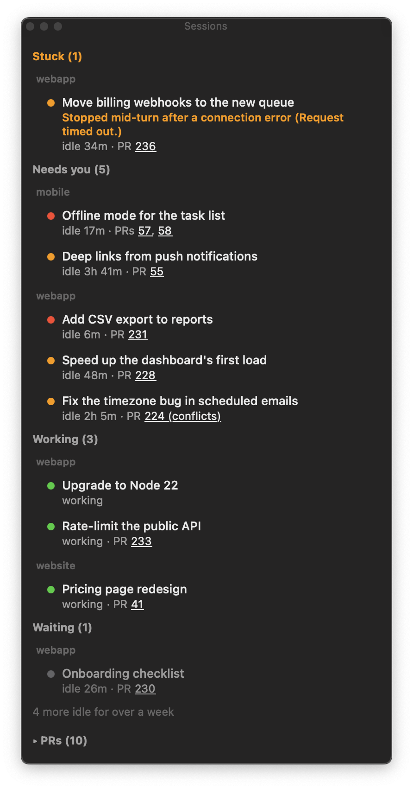
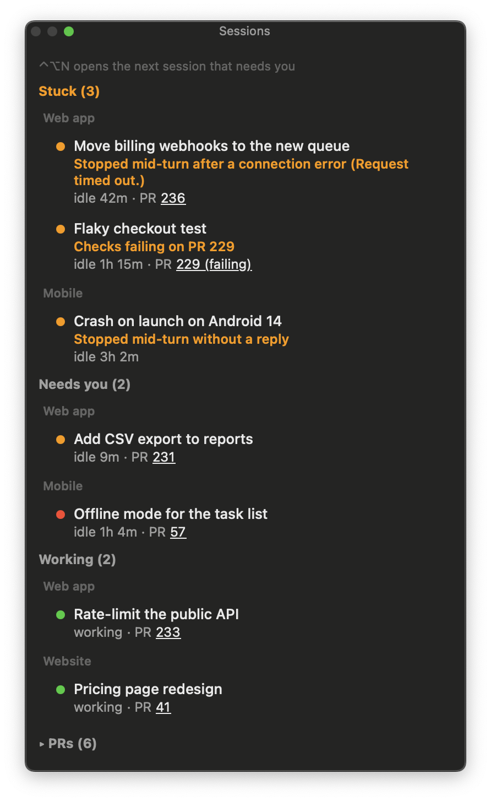
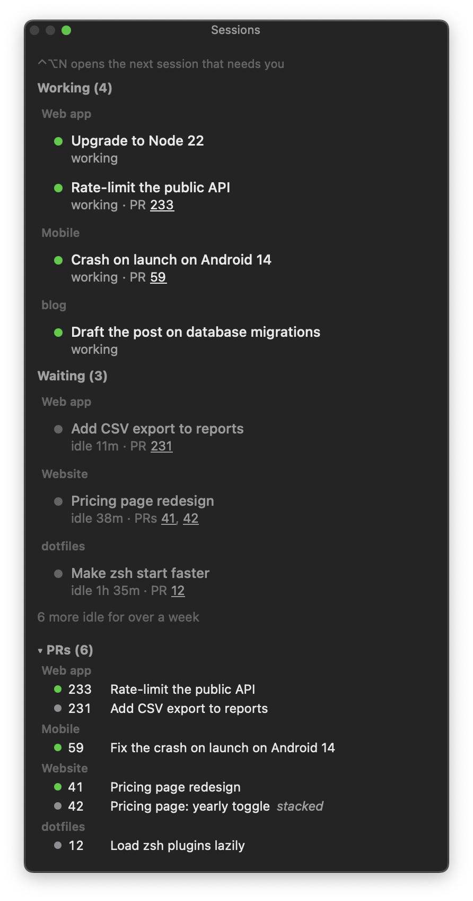
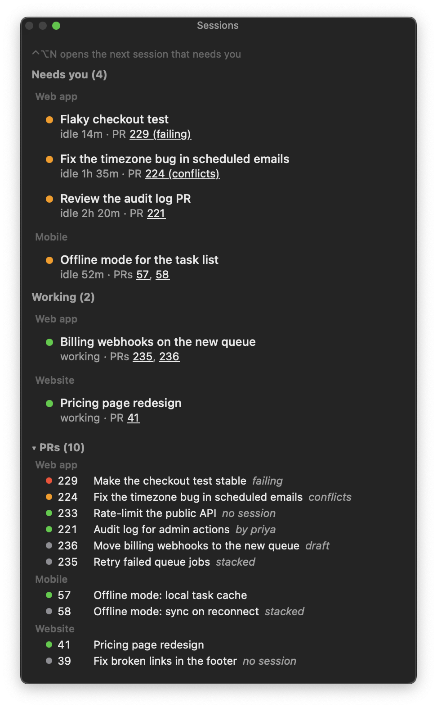
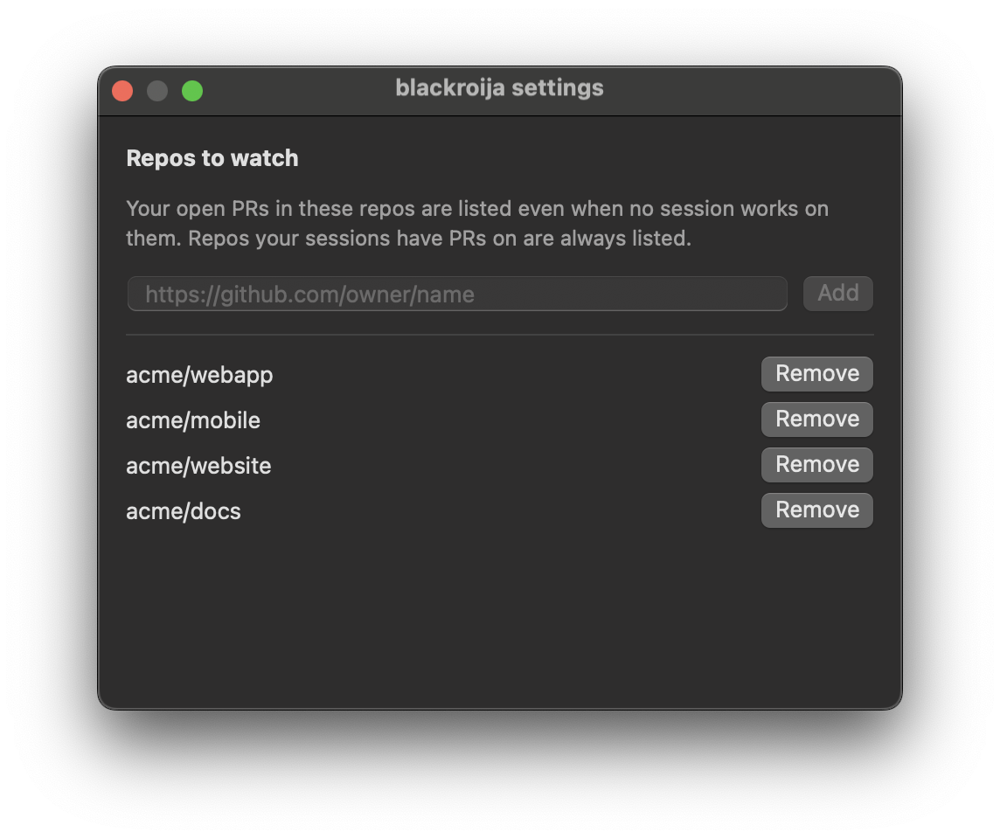

# blackroija

A small floating Mac window that lists your open Claude Code sessions (the Code tab of the Claude desktop app). It shows which sessions are working, which need you, and which are stuck, plus your open PRs. Keep it in a corner of your screen and work on one session at a time, knowing the others are fine.

It only reads files on your Mac and GitHub. It never sends anything to a session or changes a PR.

## Why use it instead of the sidebar?

The Claude desktop app's sidebar groups your sessions by project, so checking on all of them means moving from one project to the next, and it keeps every old session in view. blackroija puts all of it in one place:

- **One list, sorted by what needs you.** Not by folder: stuck sessions come first, then the ones blocked on your answer, then the rest. You see in one glance where to go next.
- **Everything you need on the row.** A red dot means blocked on you, and each row shows how long the session has been idle and its open PRs, with "(failing)" or "(conflicts)" right next to the number.
- **Always in sight.** It floats above your other windows, so you never switch to the Claude app just to check.
- **Only what's recent.** Sessions idle for over a week are hidden and counted at the bottom, so the list stays short.
- **Quiet.** No notifications, no badges. You look when you want to.

To start or archive a session, or to find an older one, use the app's own sidebar.



The screenshots here use made-up sessions and PRs.

## What you see

Sessions are sorted into sections, and grouped by repo (named after its folder) inside each section:

- **Stuck** (orange): the session stopped mid-turn (for example after a connection error), or it's idle while one of its PRs has failing checks or conflicts. A short line says which.
- **Needs you**: the session is idle and waiting on you. A red dot means it's blocked until you answer: a question card, a plan to approve, an "Allow / Deny" prompt, or something the session marked as blocking. These come first, oldest first. A session that says it's done stays here until you archive it.
- **Working** (green dot): Claude is mid-turn, or a helper agent or background job it started is still running.
- **Waiting** (dimmed): idle, but only waiting on CI or another PR.
- Sessions idle for over a week are only counted, at the bottom.

<p>
  
  
</p>

On the left, three stuck sessions come first, each with the reason. On the right, nothing needs you: every session is working or waiting on checks.

Each row shows the title, how long it's been idle and all its open PRs. A PR marked "(failing)" has failing checks, and one marked "(conflicts)" has merge conflicts. Click a row to open the session, or click a PR number to open it on GitHub. Hover over a row to see what the session is asking for.

At the bottom, **PRs** lists your own open PRs, plus teammates' PRs that an open session works on, grouped by repo. Each one shows a colored dot (red for failing checks, orange for conflicts, green for passing, gray for a draft, a stacked PR or pending checks), its number and its title. Click "PRs" to fold the list.



Right-click the window for Refresh, Settings… and Quit.

## Requirements

- macOS 14 or later.
- Swift: install the Xcode command line tools with `xcode-select --install`.
- The Claude desktop app, with sessions in the Code tab.
- The GitHub CLI (`gh`), installed with Homebrew and logged in (`gh auth login`). It's used read-only, once a minute. Without it, the window still works but shows no PRs.
- Optional: the `claude` command, logged in. It's used only when the desktop app hasn't saved a status for a session's latest reply. Haiku then reads that reply once to tell whether it waits on you, and the answer is cached in `~/Library/Application Support/blackroija/grades.json`.

## Install

```bash
git clone https://github.com/Hypefury/blackroija.git ~/workspace/blackroija
```

```bash
cd ~/workspace/blackroija && ./build.sh && open "blackroija.app"
```

To have it open at login:

```bash
cd ~/workspace/blackroija && ./install-login-item.sh
```

After changing the code, rebuild and restart it:

```bash
cd ~/workspace/blackroija && ./build.sh && pkill -x blackroija; sleep 1; open "blackroija.app"
```

## Which sessions and PRs it shows

The window shows sessions from every folder, grouped by the folder name of their repo, in name order. It finds the repo by its git folder, so worktrees count too.

The PR list covers every repo a session has an open PR on. To also see your own open PRs in repos where no session is working, right-click the window, choose **Settings…** and paste each repo's full GitHub address, like `https://github.com/owner/name`. The window checks with `gh` that you can see the repo, and the list is saved in `~/Library/Application Support/blackroija/settings.json`. Your GitHub login decides which PRs are "yours".



## Checking it from the terminal

`--print` prints the same sections and the PR groups, then exits:

```bash
cd ~/workspace/blackroija && "blackroija.app/Contents/MacOS/blackroija" --print
```

## How it works

- Sessions: `~/Library/Application Support/Claude/claude-code-sessions/*/*/local_*.json`, one file per session. Each one holds the title, folder, PRs, last activity, whether it's archived, and the status the app saves after each turn. Archived sessions are skipped.
- Conversation logs: `~/.claude/projects/*/<session>.jsonl`. They tell whether Claude is mid-turn, whether a question card or plan is unanswered, whether background work is still running, and whether the turn ended on an error.
- The desktop app's log: `~/Library/Logs/Claude/main.log`. It tells which "Allow / Deny" prompts are still unanswered, including ones a helper agent raised.
- Everything refreshes every 5 seconds, and PRs every 60 seconds.
- The window floats above other windows, stays on the desktop you put it on, and keeps running when closed. Quit it from the right-click menu.
- Opening a session uses the `claude://claude.ai/epitaxy/<session id>` link.

These files belong to the Claude desktop app and aren't a public API, so an app update can break the window. When that happens, `--print` is the quickest way to see what it reads.

## The name

Named after the Kalmah song "Black Roija": [listen to it on YouTube](https://www.youtube.com/watch?v=70pW0ozwKBU).
